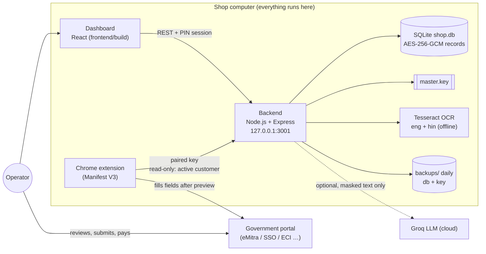

# Smart Autofill v6 — Architecture & Roadmap

This document describes the system **as it is implemented in v6**, the reasons behind the main technical decisions, and what is planned next. Every feature is labelled:

- ✅ **Implemented** — in the code and covered by tests or end-to-end checks
- 🟡 **Partial** — works, with known limits listed
- 🔜 **Planned** — not built yet (see Roadmap)

---

## 1. What the system is (and is not)

Smart Autofill is a **local, single-shop assistant** for eMitra / CSC operators. It turns a customer's documents into a verified profile, checks it against service rules the shop controls, and fills government portal forms through a browser extension **after the operator previews the values**.

It is **not**:
- an integration with eMitra, SSO Rajasthan, DigiLocker or Jan Aadhaar APIs (those require official approval — see Roadmap Phase 3);
- an automated submitter — it never clicks *Submit* or *Pay*; the operator does;
- an authority on eligibility — rules are configurable data marked *unverified* until the shop owner confirms them against official notifications.

## 2. Components



| Layer | Technology | Where |
|---|---|---|
| Dashboard | React 18 (Create React App), plain CSS, system fonts (Hindi via Nirmala UI) | `frontend/src` |
| API server | Node.js ≥ 22.13, Express 4 | `backend/server.js`, `backend/routes` |
| Storage | `node:sqlite` (built into Node, no native build) + AES-256-GCM | `backend/db`, `backend/utils/crypto.js` |
| OCR | Tesseract.js 5 (English + Hindi), sharp image clean-up, pdf.js text, pdf-lib image extraction | `backend/utils/ocr.js`, `backend/utils/pdf.js` |
| Extraction | Local regex + validators (always) + optional Groq LLM (masked, grounded) | `backend/services/extractors.js`, `groqService.js` |
| Rules | Service catalogue as data + rule engine | `backend/config/services.default.js`, `services/eligibilityEngine.js` |
| Autofill | Content script with label heuristics, preview UI, teach mode | `extension/` |

## 3. The 7 modules from the project brief → implementation

| # | Module | Status | Implementation |
|---|---|---|---|
| 1 | Document upload | ✅ | Drag-drop / file picker, one file per request with progress, type override, e-Aadhaar PDF password. Files are processed **in memory** and never written to disk (`routes/customers.js`, `DocumentsTab.js`). |
| 2 | OCR & information extraction | ✅ / 🟡 | Images: EXIF rotation, resize, greyscale, contrast, rotation retry; scanned PDFs: page images extracted and OCR'd; digital PDFs: text layer. Local extractors with checksums; optional AI with **Aadhaar masking** and **grounding** (AI values not found in the text are flagged). 🟡 Accuracy depends on photo quality; handwriting is not supported. |
| 3 | User profile creation | ✅ | Every value from every document kept as a candidate; winner = operator edit > confidence × document trust. Real conflict detection with one-click “use this value”. Removing a document removes its values (`services/profileEngine.js`). |
| 4 | Eligibility engine | ✅ / 🟡 | 11 services, 3-state results (ready / needs info / not eligible), bilingual explanations, missing documents/fields/questions. Rule values and *Verified* flags editable in Settings. 🟡 Default rules are **not verified** against official sources — the shop must confirm them. |
| 5 | Service dashboard | ✅ | Services tab per customer, residence timeline, document checks, printable checklist slip. |
| 6 | Smart autofill | ✅ / 🟡 | Extension: preview-first filling, Hindi/English labels, ASP.NET table layouts, Hindi district dropdowns, radios, postback-aware ordering, teach mode; copy buttons in the dashboard as fallback. 🟡 Tested on a mock eMitra-style form, not the live portal. |
| 7 | Review & application | ✅ | Review sheet the customer signs, application register (ref no., portal application no., fees, status, follow-ups), receipt printing, CSV export. Payment happens on the portal. |

Extra shop features (✅): customer register with search, consent + automatic end-of-day deletion, document compressor / PDF merger / photo resizer, daily backups, activity log, PIN lock, Hindi/English UI.

## 4. Request flow: from a photo to a filled form

1. **Upload** → `POST /api/customers/:id/documents` (multipart, memory only).
2. **Sniff** the real file type from its bytes (not the extension).
3. **Quality check** (sharp): resolution, blur, glare, darkness → warnings, never a hard block.
4. **Text**: digital PDF → pdf.js text; scanned PDF → page images → OCR; image → clean-up → OCR (`eng+hin`, falls back to `eng` offline).
5. **Detect type** from weighted keyword signals (operator can override).
6. **Local extraction** (always): Aadhaar (Verhoeff checksum), PAN (structure + OCR repair), EPIC, DL, passport MRZ, DOB, gender, mobile, PIN, names next to labels (Hindi/English), address + parts, marksheet class/board/year/roll/%, category, income, bank IFSC/account, issue/bill dates.
7. **AI extraction** (optional): text is masked (Aadhaar/VID/long numbers hidden) → Groq returns JSON → every value is **grounded** against the OCR text → ungrounded values kept only as low-confidence suggestions. If the configured Groq model is retired, an available one is chosen automatically.
8. **Merge**: validated local values beat AI; grounded AI beats weaker local values.
9. **Evidence**: per document — address, date/year, “is this Rajasthan?” (PIN 30xxxx–34xxxx, “Rajasthan”, BSER board, RJ licence) — used by the residence check.
10. **Profile update** + reports (residence, consistency) recomputed; record re-encrypted and saved.
11. **Eligibility** evaluated on demand per service.
12. **Apply**: dashboard sets the *active customer + service*; the extension fetches only that, shows a preview on the portal page, fills on confirmation.

## 5. Key technical decisions (and why)

| Decision | Why | Alternatives considered |
|---|---|---|
| **Local-first, single PC**, server bound to `127.0.0.1` | A kiosk handles Aadhaar data; nothing should be reachable from the shop Wi-Fi or the internet by default. | Cloud hosting (adds data-protection obligations and cost); LAN mode is possible via `HOST` but off by default. |
| **SQLite via `node:sqlite`** | Crash/power-cut safe (WAL + synchronous=FULL), fast with thousands of customers, **no native build** on Windows. v5's JSON file was rewritten fully on every save and could corrupt. | `better-sqlite3` (native compile issues on shop PCs), keeping JSON (fragile), Postgres (overkill). |
| **AES-256-GCM per record** with record id as AAD; random master key file | v5 claimed encryption but stored plain text. GCM detects tampering; AAD stops swapping blobs between records. | Deriving the key from the PIN (weak, brute-forceable offline). |
| **Rules as data, marked unverified** | Government rules change; the app must never present guesses as facts. The shop owner edits values and ticks *Verified*. | Hard-coded rules (v5 had invented income limits). |
| **Three-state rule results** (pass / fail / unknown) | “Unknown” is honest when information is missing; v5 turned missing data into “not eligible”. | Boolean eligibility. |
| **Local extractors always, AI optional** | Works offline and for free; checksums give high-confidence IDs; AI adds value for names/addresses. | AI-only (v5): privacy risk, cost, outages, hallucinations. |
| **Mask before AI + grounding after AI** | Aadhaar numbers never leave the PC; AI cannot silently invent values. | Sending raw OCR text (v5). |
| **Keep all candidate values** | Enables real conflict detection and undo; operators see *why* a value was chosen. | Keep only the winner (v5). |
| **Extension: preview + teach mode, no hard-coded portal selectors** | Live portal DOMs are unknown/changing; invented selectors could fill the wrong box. Teach mode adapts to the real eMitra pages without code changes. | Per-portal selector maps (brittle, unverifiable). |
| **Extension reads only the active customer**, paired key | A compromised/curious extension context cannot list the customer register. | v5 read “the latest profile” with no authentication. |
| **Printing via HTML** | Hindi renders correctly with system fonts; no PDF font embedding. | pdf-lib Helvetica (cannot draw Devanagari — why v5 disabled its PDF). |
| **Keep CRA + Express structure from v5** | Preserves the project's architecture and conventions; no framework churn. | Next.js/Vite migration (not needed for a local app). |

## 6. Data model

All personal data is inside encrypted `data` blobs. Plain columns are only bookkeeping.

```
customers(id, customer_no, created_at, updated_at, consent_store, delete_after, data*)
  data = { profile{…}, sources{path→winner info}, values{path→[candidates]},
           documents[{doc_type, fields, field_meta, evidence, ocr, warnings…}],
           declared{rule answers}, manual_docs{seen ticks}, consent, notes, reports{residence, consistency} }
applications(id, ref_no, customer_id, service_id, status, application_no, govt_fee,
             service_charge, amount_paid, payment_mode, created_at, updated_at, submitted_at,
             data* = {customer_name, customer_mobile, notes})
settings(key, value)          -- app settings, service overrides, PIN hash, secret:* (encrypted)
audit_log(id, ts, action, entity, entity_id, meta)   -- never personal data
```
`*` = AES-256-GCM, AAD = `table:id`. Raw OCR text and images are **never stored**.

Field vocabulary (labels in English/Hindi, groups, validators) lives in one place: `backend/config/catalog.js`, shared by the API, the dashboard (via `/api/meta/catalog`) and the extension's preview labels.

## 7. Security & privacy model

| Risk | Mitigation in v6 |
|---|---|
| Someone on the shop Wi-Fi reads customer data | Server listens on 127.0.0.1 only; all APIs need a PIN session or the extension key. |
| Someone uses the shop PC | PIN login, lockout after wrong attempts, idle auto-lock, *Lock* button. |
| Data file copied / shared (e.g. a zip of the project) | Records encrypted; key in a separate file; `.gitignore` excludes data, keys, `.env`, logs. |
| Data kept longer than needed | Consent per customer; unconsented customers deleted at end of day; optional retention days; delete button; data wipe. |
| Aadhaar sent to a cloud AI | Masked before sending; AI can be turned off; local extraction always works. |
| Wrong customer's data filled into a form | Active-customer model, name + Aadhaar last-4 shown in the preview, “Done — next customer” clears it. |
| Malicious pages talking to the extension | Pairing accepted only from a localhost dashboard page via the background worker; no page-wide listeners on portals. |
| Clickjacking / script injection in the dashboard | CSP (`script-src 'self'`), `X-Frame-Options: DENY`, nosniff, no inline scripts (`INLINE_RUNTIME_CHUNK=false`). |
| Lost key / disk failure | Daily backups of database + key (keep a copy offline); restore steps in each backup's README. |

**Residual risks (your responsibility):** keep the PC's Windows login private, keep backups (they contain the key) physically safe, keep the PIN secret, review AI suggestions, verify rules. India's DPDP Act 2023 expects consent, purpose limitation and deletion — the consent/auto-delete features support this, but the shop remains responsible for its practices.

## 8. API overview

| Area | Endpoints |
|---|---|
| Auth | `GET /api/auth/status`, `POST /api/auth/setup`, `POST /api/auth/login`, `POST /api/auth/logout`, `POST /api/auth/change-pin` |
| Customers | `GET/POST /api/customers`, `GET/PATCH/DELETE /api/customers/:id`, `POST /api/customers/:id/choose`, `POST /api/customers/:id/documents`, `PATCH/DELETE /api/customers/:id/documents/:docId`, `GET /api/customers/:id/services[/:serviceId]`, `GET /api/customers/:id/export`, `GET/POST/DELETE /api/customers/active` |
| Applications | `GET/POST /api/applications`, `PATCH/DELETE /api/applications/:id`, `GET /api/applications/summary`, `GET /api/applications/export.csv` |
| Settings | `GET /api/settings`, `PUT /api/settings/section/:section`, `PUT /api/settings/services/:id`, `POST /api/settings/services/:id/reset`, `GET /api/settings/extension-key`, `POST /api/settings/backup`, `GET /api/settings/audit`, `POST /api/settings/test-ai`, `POST /api/settings/wipe` |
| Tools | `POST /api/tools/compress`, `POST /api/tools/resize` |
| Extension | `GET /api/ext/ping`, `GET /api/ext/active` (header `X-Extension-Key`) |
| Other | `GET /api/meta/catalog`, `GET /api/ai/status`, `POST /api/ai/ask`, `GET /health` |

## 9. Testing

`cd backend && npm test` runs 43 tests (`node --test`):
- validators & extractors on fake Aadhaar/PAN/voter/bill/marksheet/DL text (incl. Hindi);
- profile merge, conflicts, manual edits, residence years, consistency checks, eligibility rules;
- a full API run on a throwaway database (PIN, customers, upload, rules settings, applications, CSV, extension key, tools, backup) that also **asserts the database file contains no plain-text name, Aadhaar or mobile**;
- OCR on generated images and scanned PDFs (JPEG and PNG page encodings).

End-to-end checks done for v6 (manual, with watermarked fake documents): upload of 5 documents through OCR + AI, eligibility, application recording, Hindi UI, and the extension filling a mock eMitra-style form (18/18 fields, captcha untouched, postback dropdown last).

## 10. Roadmap

### Phase 1 — v6 (this release) ✅
Shop-ready local app: encryption, PIN, registers, OCR + Hindi, configurable rules, extension with preview & teach mode, tools, printing, backups, docs.

### Phase 2 — next improvements (no government approval needed) 🔜
1. **Verify rules with official sources** and ship a reviewed default set per service (owner task + small UI to record the source link/date per rule).
2. **Share taught field mappings**: export/import extension mappings so one shop's teaching of an eMitra page helps others; ship mappings for common eMitra services once verified on the live portal.
3. **Phone upload via QR code** on the shop LAN (customers' WhatsApp photos straight into the app) — needs a one-time upload token and LAN mode.
4. **Photo & signature cropping** from scanned documents + per-portal size presets confirmed with the portals.
5. **Hindi ↔ English transliteration** helper for name/address fields required in both scripts.
6. **Application status reminders** (follow-up list already exists) and daily cash report printout.
7. **Multi-operator accounts** (owner vs staff PINs, per-user audit).
8. **Installer** (Windows service / tray app) so the server starts with the PC.

### Phase 3 — integrations that need official approval 🔜
- **DigiLocker** (APISetu requester) — the OAuth code path exists (`routes/digilockerAuth.js`) but is untested with real credentials; the simulated flow is demo-only.
- **Jan Aadhaar / Rajasthan APIs** for verified family data.
- Status lookups from portals, only where an official API exists.

### Explicitly not planned
- Automatic submission or payment on government portals.
- Bypassing captchas or OTPs.

## 11. Known limitations

- Extension heuristics have not been run on the live eMitra portal (login required); use *Teach fields* and report pages that need better defaults.
- OCR cannot read handwriting and struggles with very poor photos; the quality warnings say how to retake.
- Residence years are estimated from **dated** documents only; Aadhaar usually has no date and proves only the current address.
- Default eligibility rules are **unverified** starting points.
- Single PIN for the shop (no per-staff accounts yet).
- `setup.bat` / `start-shop.bat` target Windows; the code itself is cross-platform.
